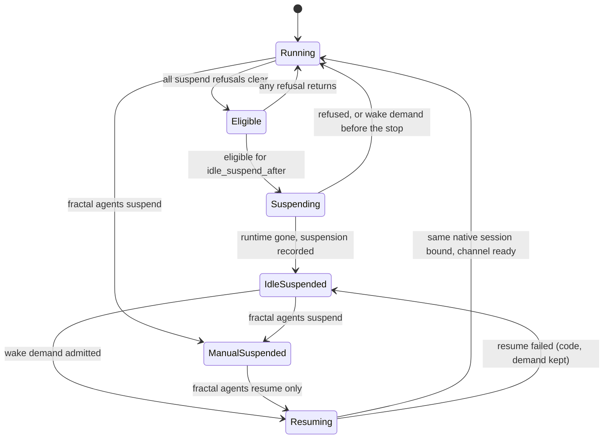

# Idle residency

A quiet seat holds memory while it waits. Idle residency lets the owner daemon
[suspend](suspend.md) a seat that has been quiet for a configured time and resume it on its
exact native session when an event that wakes it arrives. Nothing outside the daemon decides
residency: no host timer, client or harness extension suspends or resumes seats.

Status: **specified, not implemented.** Today only `fractal agents resume` ends a suspension.

## Requirements

- **IDLE-R01 One controller:** Only the seat's placement owner daemon suspends or resumes a seat for
  idleness. Harnesses, clients and fleet tooling never do, and no peer originates a second resume.
- **IDLE-R02 Member opt-in, seat opt-out:** Idle suspension is off unless the owner member enables
  it. An enabled member applies it to every eligible seat it owns except seats whose declaration
  opts out.
- **IDLE-R03 Existing safety only:** An idle suspend never weakens a [suspend](suspend.md#when-a-seat-can-suspend)
  refusal. A seat that holds claimed work, runs a subagent, has a turn, prompt, unsent input or
  background job, or has no bound native session stays resident.
- **IDLE-R04 Eligible-time TTL:** A seat suspends after it has been continuously eligible for the
  member's idle time, measured from when it became eligible. Silent mail does not restart the
  clock; anything that makes the seat ineligible does.
- **IDLE-R05 Wake set:** A message that [wakes](silent-messages.md) a running seat resumes an
  idle-suspended seat. Silent mail never does; it stays held until the next wake.
- **IDLE-R06 No lost wake:** Every wake-class message accepted for an idle-suspended seat leads to
  a resume and then to delivery through the ordinary receipts, at least once, across daemon
  restarts, replication delay and races with an in-flight suspend.
- **IDLE-R07 Same session or a visible failure:** Resume continues the exact native session. A
  failed resume leaves the seat suspended with its code and its pending wake visible; it never
  falls back to a fresh conversation.
- **IDLE-R08 Precedence:** A manual suspension, stop or retirement is never undone by pending
  wake demand. Only explicit resume ends a manual suspension.
- **IDLE-R09 Same host:** Idle suspension and its resume stay on the seat's placement host.
- **IDLE-R10 Workspace coverage:** A seat whose workspace cannot take a Git snapshot (not a
  repository root, unborn, or containing submodules) still idle-suspends, with its workspace left
  in place and its suspension pinned to the host.
- **IDLE-R11 Bounded wake admission:** A member resumes at most a configured number of seats at
  once. Person messages are admitted before other demand; no priority bypasses host admission holds.
- **IDLE-R12 No polling:** The daemon records each seat's next idle deadline and wakes on it; it
  does not scan seats on a timer.
- **IDLE-R13 Explainable:** `fractal agents show` states whether a seat is eligible, since when,
  when it is due, why it is not, the suspension's cause, and its oldest pending wake.
- **IDLE-R14 Falsifiable tradeoffs:** Telemetry shows when the idle time, the wake set or the
  coverage is wrong: churn, wakes without a turn, held silent age, unrouted activity, refusals by
  reason, wake latency, resume failures and measured memory released. Objectives with an error
  budget raise a fault when a bound is missed; people or agents change the policy, the daemon
  does not tune itself.

## Configuration

The member enables idle suspension in its daemon configuration. The setting is read again
without a restart, like the [idle-holder](mission-graph-runtime.md#idle-holders) settings.

```toml
[reconcile]
idle_suspend_after = "30m"   # default "off"; any duration enables it on this member
idle_resume_concurrency = 2  # resumes this member runs at once
```

`30m` is the recommended starting value. A seat opts out in its declaration:

```kdl
agent "example/responder" {
  host "amber"
  workspace "/srv/example/responder"
  idle-suspend "never"
}
```

`idle-suspend` takes `"never"` or `"member"` (the default: follow the member's setting). Any other
value is refused at validation.

## Lifecycle



The suspension records its **cause**: `manual` for `fractal agents suspend`, `idle` for this
policy. The runtime state stays `suspended` for both; cause is a separate field so the phases in
[suspend](suspend.md#phases) keep their meaning. An explicit suspend of an idle-suspended seat
changes the cause to `manual`, which turns off automatic wake.

## Eligibility and the idle clock (IDLE-R03, IDLE-R04, IDLE-R12)

A seat is eligible when its member enables idle suspension, its declaration does not opt out, and
every [suspend refusal](suspend.md#when-a-seat-can-suspend) is clear on the latest observations.
Missing or indeterminate observations are not eligible.

The **eligible epoch** is the time the seat last became eligible. It is derived from the claims
that change eligibility (`harness.observed`, work claims and leases, subagent claims, runtime
observations) and is never `last_activity_at`: received mail counts as activity there, so silent
mail would hold a seat awake. The seat is due at `eligible epoch + idle_suspend_after`. The check
runs inside the seat's existing wake evaluation, which records the exact due time as its next
deadline.

## Suspend admission (IDLE-R01, IDLE-R03, IDLE-R06)

At the due time the owner runs the ordinary suspend operation with cause `idle`:

1. Under the owner writer, fence the declaration, the running incarnation, the policy setting and
   the eligible epoch, and record the seat's **demand frontier**: the newest accepted message to it.
2. Run the suspend refusal checks again. Any refusal ends the attempt; the seat stays running and
   the refusal is recorded once per epoch, not once per deadline.
3. Wake-class demand accepted after the frontier and before the runtime stop cancels the attempt.
4. Demand accepted after the stop has begun is latched: the suspend completes, then the seat goes
   straight to wake admission. Two processes for one seat never race.

## Snapshot modes (IDLE-R09, IDLE-R10)

| mode | when | what suspend keeps | cross-host resume |
| --- | --- | --- | --- |
| `git` | the workspace takes a [Git snapshot](suspend.md#cross-host-continuation) | snapshot commit, native session, frozen transcript | allowed for manual suspensions as today |
| `in-place` | the workspace refuses with `workspace-not-git`, `workspace-unborn`, `workspace-not-root` or `workspace-submodule-unsupported` | native session binding and frozen transcript; the workspace stays where it is | refused with `snapshot-in-place` |

An idle suspension never moves hosts in either mode. `in-place` is only available to cause `idle`;
a manual suspend keeps today's refusals. Resume in either mode uses the same strict native resume.

## Wake demand (IDLE-R05, IDLE-R06, IDLE-R08)

**Wake demand** is the set of wake-class messages to an idle-suspended seat accepted after its
demand frontier and not yet offered. It is derived from the native message stream: every
`message.sent` claim for the recipient, wherever the store keeps it, including the messages
shard, joined with its staged, delivered and read receipts. The primary claim log alone is not
enough: it does not hold sends kept in the messages shard. The existing local message index that
the idle-holder check uses records pending wake-class input per seat, so a seat's demand is one
indexed read. After a restart, demand is derived again from accepted sends and receipts; nothing
in memory is load-bearing.

Classification is the one [silent and wake](silent-messages.md) rule, decided at acceptance:
person messages, ready steps, faults, GitHub watch events, handoffs, run reports and daemon
notices always wake; agent messages tagged `st3-silent` never do. Idle residency adds no second
classifier.

Demand to a manually suspended, stopped or retired seat stays in the mailbox and does not resume it.

## Wake admission and resume (IDLE-R07, IDLE-R11)

1. Demand admits **one** resume operation per `(seat, suspension operation)`, with that pair as
   its idempotency key. More demand while it runs joins the same operation.
2. The member runs at most `idle_resume_concurrency` resumes. Queued seats are ordered by their
   oldest person message, then by oldest demand.
3. Resume runs the existing restore and verify phases. The seat is resumed only when the live
   native session matches and the driver reports its delivery channel ready.
4. Pending mail is then offered through the ordinary mailbox stream: wake messages first in
   canonical order, plus the held silent batch. Delivery is at least once; a crash between native
   delivery and its receipt can replay a message.
5. A failed resume returns the seat to `IdleSuspended` with its code, keeps the demand, and retries
   with backoff only after the code's condition changes or its retry time passes. A
   `transcript-missing` or `native-session-mismatch` failure needs explicit repair; it does not
   retry.

Resume starts a new idle clock: the seat becomes eligible again only after it is quiet again.

## Observability (IDLE-R13, IDLE-R14)

`fractal agents show` adds a `residency` block: `eligible` with its epoch and due time, or the
refusal reasons; the suspension cause and snapshot mode; and the oldest pending wake with its age.

Instruments follow [metric naming and cardinality](observability.md#metric-naming-and-cardinality).
Every label is a closed vocabulary; seat identity stays in spans and `agents show`.

| Instrument | Type | Unit | Labels | Shows |
| --- | --- | --- | --- | --- |
| `st.residency.suspends` | Counter | — | `result`: `suspended`, `refused`, `cancelled` | suspend outcomes |
| `st.residency.refusals` | Counter | — | `reason`: suspend refusal code, else `other` | coverage lost, once per epoch |
| `st.residency.wakes` | Counter | — | `source`: `person`, `agent`, `daemon`, `github`; `outcome`: `turn`, `no-turn` | wake mix; wakes not followed by a turn within 10 minutes |
| `st.residency.wake.duration` | Histogram | `s` | `phase`: `admitted`, `resumed`, `first-turn` | accepted wake to each phase |
| `st.residency.resume.failures` | Counter | — | `code`: resume failure code, else `other` | resume failures |
| `st.residency.short_sleeps` | Counter | — | — | idle suspensions woken within `idle_suspend_after` |
| `st.residency.unrouted` | Counter | — | `kind`: `attach`, `explicit-resume` | someone needed an idle-suspended seat awake with no wake demand pending |
| `st.residency.suspended` | Observable gauge | — | `cause`: `idle`, `manual` | seats suspended now |
| `st.residency.pending.oldest_age` | Observable gauge | `s` | `class`: `wake`, `silent` | oldest pending demand and held silent mail |
| `st.residency.reclaimed` | Histogram | `By` | `measure`: `host-available`, `private` | measured change around each suspend, never a sum of resident sizes |

Each suspend and resume operation is one trace with the seat in span attributes and the phase as
`span.label`.

Objectives over these signals, with their targets and error budgets, are DQ1.

## Design questions

- **DQ1 Objective set:** which objectives cover IDLE-R14, their indicators, targets, windows and
  on-breach owner. Resolved by a replay-calibrated bakeoff of candidate objective formulations.
- **DQ2 Harness-local timers:** a harness timer or loop that would start a turn without a message
  never fires while the seat is suspended. A 13-day replay of one fleet's claim log found under one
  turn start a day with no message behind it, and every sampled start traced to a message.
  Suspension hides such turns rather than showing them, so a driver that keeps harness timers
  reports them as a suspend refusal or declares them as durable daemon deadlines.
- **DQ3 Claude import:** an imported resumed Claude seat does not load the Fractal channel, so it
  cannot be woken. Until a driver reports channel readiness for it, such a seat is not eligible.
- **DQ4 Parked work:** seats holding claimed work stay resident (IDLE-R03). Letting the daemon keep
  a lease while the holder sleeps is a separate contract.
- **DQ5 Fresh-context seats:** a `fresh-context` seat starts a new conversation for each step. Its
  wake may not need strict resume; until specified, it follows the same strict resume.

## Evidence

A counterfactual replay of 13 days of one fleet's claims (97 seats, 98,189 messages, the idle
time at 30 minutes) estimated about 26 seats suspended at any time, 110 idle suspends and 104 wakes
a day, 97% of wakes followed by a turn within 10 minutes, and under one unexplained activity start
a day. Waking on silent mail as well added about five wakes a day, most not followed by a turn,
without measurably more suspended time; silent mail waited a median 1.3 hours for the next wake.
Historical manual resumes took a median 9.7 seconds from request to verified resume. These are
estimates from history, not measured memory release; IDLE-R14 makes the released memory measured.
