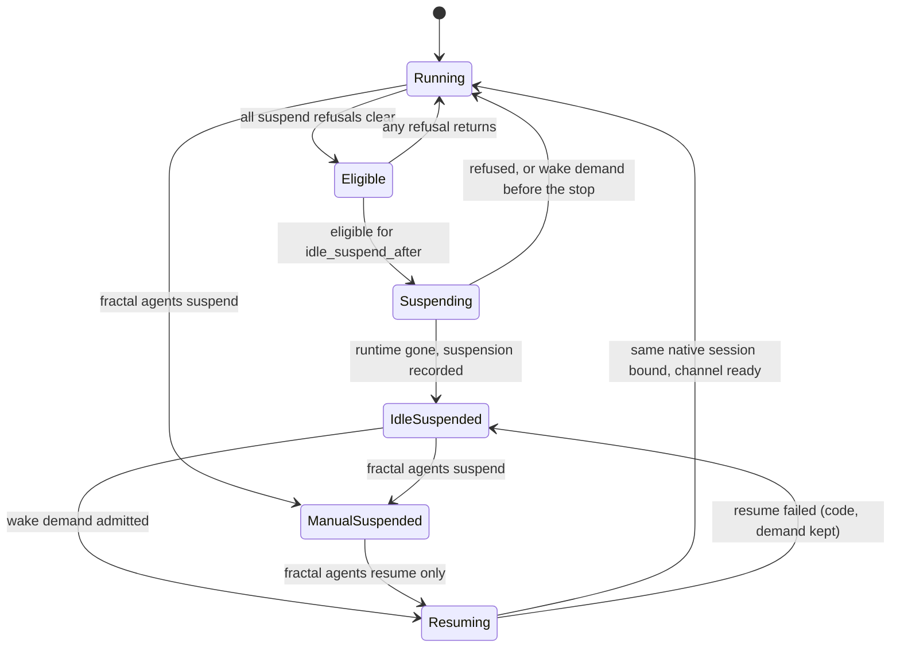

# Idle residency

A quiet seat holds memory while it waits. Idle residency lets the owner daemon
[suspend](suspend.md) a seat that has been quiet for a configured time and resume it on its
exact native session when an event that wakes it arrives. Nothing outside the daemon decides
residency: no host timer, client or harness extension suspends or resumes seats.

Status: **specified, not implemented.** Today only `fractal agents resume` ends a suspension.

## Requirements

- **IDLE-R01 One controller:** Only the seat's placement owner daemon suspends or resumes a seat for
  idleness. Harnesses, clients and fleet tooling never do, and no peer originates a second resume.
- **IDLE-R02 Member opt-in, seat opt-out:** Idle suspension is off unless the owner member enables
  it. An enabled member applies it to every eligible seat it owns except seats whose declaration
  opts out. Turning the policy off or opting out stops new idle suspends, not automatic wakes of
  seats already idle-suspended.
- **IDLE-R03 Existing safety only:** An idle suspend never weakens a [suspend](suspend.md#when-a-seat-can-suspend)
  refusal. A seat that holds claimed work, runs a subagent, has a turn, prompt, unsent input or
  background job, or has no bound native session stays resident. Eligibility also requires a driver
  that declares idle-residency support and reports its delivery channel ready; otherwise refuse
  with `driver-unsupported` or a channel-not-ready refusal. Only omp declares support initially.
- **IDLE-R04 Eligible-time TTL:** A seat suspends after it has been continuously eligible for the
  member's idle time, measured from when it became eligible. Silent mail does not restart the
  clock; anything that makes the seat ineligible does.
- **IDLE-R05 Wake set:** A message that [wakes](silent-messages.md) a running seat resumes an
  idle-suspended seat. Silent mail never does; it stays held until the next wake.
- **IDLE-R06 No lost wake:** Every wake-class message accepted for an idle-suspended seat leads to
  a resume and then to delivery through the ordinary receipts, at least once, across daemon
  restarts, replication delay and races with an in-flight suspend.
- **IDLE-R07 Same session or a visible failure:** Resume continues the exact native session. A
  failed resume leaves the seat suspended with its code and its pending wake visible; it never
  falls back to a fresh conversation.
- **IDLE-R08 Precedence:** A manual suspension, stop or retirement is never undone by pending
  wake demand. Only explicit resume ends a manual suspension.
- **IDLE-R09 Same host:** Idle suspension and its resume stay on the seat's placement host.
- **IDLE-R10 Workspace coverage:** A seat whose workspace cannot take a Git snapshot (not a
  repository root, unborn, or containing submodules) still idle-suspends, with its workspace left
  in place and its suspension pinned to the host.
- **IDLE-R11 Bounded wake admission:** A member resumes at most a configured number of seats at
  once. Person messages are admitted before other demand; no priority bypasses host admission holds.
- **IDLE-R12 No polling:** The daemon records each seat's next idle deadline and wakes on it; it
  does not scan seats on a timer.
- **IDLE-R13 Explainable:** `fractal agents show` states whether a seat is eligible, since when,
  when it is due, why it is not, the suspension's cause, and its oldest pending wake.
- **IDLE-R14 Falsifiable tradeoffs:** Telemetry shows when the idle time, the wake set or the
  coverage is wrong: churn, wakes without a turn, held silent age, unrouted activity, refusals by
  reason, wake latency, resume failures and measured memory released. Objectives with an error
  budget raise a fault when a bound is missed; people or agents change the policy, the daemon
  does not tune itself.

## Configuration

The member enables idle suspension in its daemon configuration. The setting is read again
without a restart, like the [idle-holder](mission-graph-runtime.md#idle-holders) settings.

```toml
[reconcile]
idle_suspend_after = "30m"   # default "off"; any duration enables it on this member
idle_resume_concurrency = 2  # resumes this member runs at once
```

`30m` is the recommended starting value. A seat opts out in its declaration:

```kdl
agent "example/responder" {
  host "amber"
  workspace "/srv/example/responder"
  idle-suspend "never"
}
```

`idle-suspend` takes `"never"` or `"member"` (the default: follow the member's setting). Any other
value is refused at validation.

Setting `idle_suspend_after = "off"` or `idle-suspend "never"` must leave existing idle suspensions
wakeable through the same demand, admission and strict resume path. These settings must not turn
an idle suspension into a manual suspension.

## Lifecycle



The suspension records its **cause**: `manual` for `fractal agents suspend`, `idle` for this
policy. The runtime state stays `suspended` for both; cause is a separate field so the phases in
[suspend](suspend.md#phases) keep their meaning. An explicit suspend of an idle-suspended seat
changes the cause to `manual`, preserving its snapshot and native session and disabling automatic
wake. This conversion is idempotent; a manual suspension never converts to idle automatically.

### Compatibility

Under [R49](compatibility.md#required-rolling-window), readers for new residency claim kinds and
suspension fields must ship before their writers. A missing cause reads as `manual`; a missing
snapshot mode reads as `git`. Writers must remain gated until every active member advertises
support for reading the new kinds and fields, including evidence claims. Current-only tests do
not satisfy this gate. Downgrade is not promised. Rollback means setting the policy off and
rolling forward with compatible readers and the wake path for existing idle suspensions intact.

The writer barrier is the existing signed fleet feature protocol:
`daemon.started.features.idle_residency = 1`. Admission requires an anchored,
non-conflicted active local membership and the latest signed advertisement from
every active member's current incarnation. A missing, unsigned or withdrawn
advertisement refuses admission; an older positive advertisement is never a fallback.
The same feature covers suspension provenance, wake admission and residency evidence
readers. It is not an operator assertion or a comparison of version strings.

Activation requires both that barrier and a member `idle_suspend_after` other than
`"off"`. Turning the policy off, or declaring `idle-suspend "never"`, prevents new
stops without cancelling queued wakes for existing idle suspensions. Manual
suspensions remain outside automatic admission. The stop and wake paths are one
cutover: a binary cannot advertise this feature while implementing only one side.

## Eligibility and the idle clock (IDLE-R03, IDLE-R04, IDLE-R12)

A seat is eligible when its member enables idle suspension, its declaration does not opt out, and
the driver declares idle-residency support, its delivery channel is ready, and every
[suspend refusal](suspend.md#when-a-seat-can-suspend) is clear on the latest observations.
Unsupported drivers refuse with `driver-unsupported`; only omp declares support initially.
Missing or indeterminate observations, including channel readiness, are not eligible.

The **eligible epoch** is the time the seat last became eligible. It is derived from the claims
that change eligibility (`harness.observed`, work claims and leases, subagent claims, runtime
observations) and is never `last_activity_at`: received mail counts as activity there, so silent
mail would hold a seat awake. The epoch is never earlier than the time this daemon loaded a policy
that enables idle suspension, so turning the policy on, and every daemon restart, gives every seat
a full `idle_suspend_after` before its first idle suspend; no seat is suspended because it was
quiet before the policy applied. The seat is due at `eligible epoch + idle_suspend_after`. The
check runs inside the seat's existing wake evaluation, which records the exact due time as its
next deadline.

## Suspend admission (IDLE-R01, IDLE-R03, IDLE-R06)

At the due time the owner runs the ordinary suspend operation with cause `idle`:

1. Under the owner writer, fence the declaration, the running incarnation, the policy setting and
   the eligible epoch, and record the seat's **demand frontier**: the newest accepted message to it.
2. Run the suspend refusal checks again, plus `wake-pending`: the wake-demand projection, read at
   the frontier, shows a wake-class message to the seat that is not yet offered. A lagging
   projection refuses too. Any refusal ends the attempt; the seat stays running and the refusal is
   recorded once per epoch, not once per deadline.
3. Wake-class demand accepted after the frontier and before the runtime stop cancels the attempt.
4. Demand accepted after the stop has begun is latched: the suspend completes, then the seat goes
   straight to wake admission. Two processes for one seat never race.

## Snapshot modes (IDLE-R09, IDLE-R10)

| mode | when | what suspend keeps | cross-host resume |
| --- | --- | --- | --- |
| `git` | the workspace takes a [Git snapshot](suspend.md#cross-host-continuation) | snapshot commit, native session, frozen transcript | allowed for manual suspensions as today |
| `in-place` | the workspace refuses with `workspace-not-git`, `workspace-unborn`, `workspace-not-root` or `workspace-submodule-unsupported` | native session binding and frozen transcript; the workspace stays where it is | refused with `snapshot-in-place` |

An idle suspension never moves hosts in either mode. `in-place` is only available to cause `idle`;
a manual suspend keeps today's refusals. Resume in either mode uses the same strict native resume.

## Wake demand (IDLE-R05, IDLE-R06, IDLE-R08)

**Wake demand** is the set of wake-class messages to an idle-suspended seat that are not yet
offered. Suspend admission guarantees that none were outstanding at the frontier, so every message
in it was accepted after the frontier. It is derived from the native message stream:
every `message.sent` claim for the recipient, wherever the store keeps it, including the messages
shard, joined with its staged, delivered and read receipts. The primary claim log alone is not
enough: it does not hold sends kept in the messages shard. The existing idle-mail pending index
tracks any pending input; it is neither wake-class-aware nor staging-aware. It must not be reused
as wake demand. A new wake-class, staged/receipt-aware per-seat pending projection must cover
both stores and make demand one indexed read. A lagging source mirror cannot prove no demand.
After a restart, the projection rebuilds from accepted sends, staging and receipts; nothing in
memory is load-bearing.

Classification is the one [silent and wake](silent-messages.md) rule, decided at acceptance:
person messages, ready steps, faults, GitHub watch events, handoffs, run reports and daemon
notices always wake; agent messages tagged `st3-silent` never do. Idle residency adds no second
classifier.

Demand to a manually suspended, stopped or retired seat stays in the mailbox and does not resume it.

## Wake admission and resume (IDLE-R07, IDLE-R11)

1. Demand admits **one** resume operation per `(seat, suspension operation)`, with that pair as
   its idempotency key. More demand while it runs joins the same operation.
2. The member runs at most `idle_resume_concurrency` resumes. Queued seats are ordered by their
   oldest person message, then by oldest demand.
3. Resume runs the existing restore and verify phases. The seat is resumed only when the live
   native session matches and the driver reports its delivery channel ready for that incarnation.
   Process liveness or session equality alone must not complete resume or release pending mail.
4. Pending mail is then offered through the ordinary mailbox stream: wake messages first in
   canonical order, plus the held silent batch. Delivery is at least once; a crash between native
   delivery and its receipt can replay a message.
5. A failed resume returns the seat to `IdleSuspended` with its code, keeps the demand, and retries
   with backoff only after the code's condition changes or its retry time passes. A
   `transcript-missing` or `native-session-mismatch` failure needs explicit repair; it does not
   retry.

Resume starts a new idle clock: the seat becomes eligible again only after it is quiet again.

## Observability (IDLE-R13, IDLE-R14)

`fractal agents show` adds a `residency` block: `eligible` with its epoch and due time, or the
refusal reasons; the suspension cause and snapshot mode; and the oldest pending wake with its age.

Instruments follow [metric naming and cardinality](observability.md#metric-naming-and-cardinality).
Every label is a closed vocabulary; seat identity stays in spans and `agents show`.

| Instrument | Type | Unit | Labels | Shows |
| --- | --- | --- | --- | --- |
| `st.residency.suspends` | Counter | — | `result`: `suspended`, `refused`, `cancelled` | suspend outcomes |
| `st.residency.refusals` | Counter | — | `reason`: suspend refusal code, else `other` | coverage lost, once per epoch |
| `st.residency.wakes` | Counter | — | `source`: `person`, `agent`, `daemon`, `github`; `outcome`: `turn`, `no-turn` | wake mix; wakes not followed by a turn within 10 minutes |
| `st.residency.resume.failures` | Counter | — | `code`: resume failure code, else `other` | resume failures |
| `st.residency.short_sleeps` | Counter | — | — | idle suspensions woken within `idle_suspend_after` |
| `st.residency.unrouted` | Counter | — | `kind`: `attach`, `explicit-resume` | someone needed an idle-suspended seat awake with no wake demand pending |
| `st.residency.suspended` | Observable gauge | — | `cause`: `idle`, `manual` | seats suspended now |
| `st.residency.pending.oldest_age` | Observable gauge | `s` | `class`: `wake`, `silent` | oldest pending demand and held silent mail |
| `st.residency.reclaimed` | Observable gauge | `By` | `measure`: `host-available`, `private` | measured change around the latest suspend, never a sum of resident sizes |

Latency percentiles come from the wake objectives' `interval` rows rather than a histogram.
Residency's allocation is taken from the HTTP duration cap, not additional headroom; the
[shared allocation](observability.md#cardinality-budget) must be inventoried before activation.

Each suspend and resume operation is one trace with the seat in span attributes and the phase as
`span.label`.

Metrics feed dashboards. Objectives read the durable evidence claims below, so a missed target
is judged from the same records on every member.

## Objectives (IDLE-R14)

The owner daemon writes one evidence claim per logical episode under
`residency/<host>/...`. Retried writes repeat the same subject and event time, so at-least-once
writing does not inflate a sample. Seat, session and source message stay in claim fields, never
in metric labels.

| Subject suffix | Kind | Fields | Written |
| --- | --- | --- | --- |
| `wake/<demand id>` | `residency.wake-demand` | `host`, `demand_at`, `origin_accepted_at`, source message, suspended incarnation | when the first wake-class message for the suspension reaches the owner, before admission; `demand_at` is the owner's receipt, `origin_accepted_at` the sender member's acceptance |
| same | `residency.resumed` | `host`, `resumed_at`, native session, incarnation | when the exact session is bound and its channel is ready |
| same | `residency.first-turn` | `host`, `first_turn_at`, turn identity | at the resumed incarnation's first native turn |
| `outcome/<operation id>` | `residency.outcome` | `host`, `observed_at`, `resume_failed` 0/1, `useless` 0/1, bounded `reason` | on failure or deadline, or 10 minutes after a verified resume |
| `sleep/<suspension id>` | `residency.sleep-ended` | `host`, `suspended_at`, `ended_at`, `short_sleep` 0/1, `end_class` | when an idle suspension ends; `short_sleep` is 1 below `idle_suspend_after` |
| `eligibility/<epoch id>` | `residency.eligibility-outcome` | `host`, `eligible_since`, `decided_at`, `refused` 0/1, bounded `reason` | once per eligible epoch that reaches its due time |
| `unrouted/<incident id>` | `residency.unrouted` | `host`, `observed_at`, `kind` | on terminal attach or explicit resume of an idle-suspended seat with no wake demand |
| `host/<host>` | `residency.host-sample` | `host`, `observed_at`, `held_silent_age_seconds`, `asleep_seats`, memory deltas with coverage | every 5 minutes on an enabled member; a failed sensor writes no age, never zero |

Unrouted incidents are owner-local and reader-barrier gated. Terminal attachment (including
local-terminal lookup) and explicit resume record at most one incident per suspend operation
and kind, including across retries and daemon restarts. The owner validates a caught-up,
unchanged wake frontier under the source and graph writer fences before recording absence
of wake demand; lag is unknown, not an incident. Manual suspension never records one.
Only a newly committed incident increments the bounded `kind` counter.

A fleet declares objectives over these claims with `fractal apply`, one set per enabled member,
each with an `only "host"` filter so a busy member cannot hide a quiet one. The recommended set
uses seven-day windows, because one-day windows on a member with few wakes are mostly no-data:

| Objective | Indicator | Target |
| --- | --- | --- |
| wake → first turn | `interval` `wake-demand` → `first-turn`; unfinished demand counts as slow | p95 ≤ 120 s, min 20 samples |
| wake → resumed | `interval` `wake-demand` → `resumed` | p95 ≤ 60 s, min 20 samples |
| resume failures | `ratio` over `outcome`, bad when `resume_failed` > 0 | < 1%, min 10 |
| useless wakes | `ratio` over `outcome`, bad when `useless` > 0 | < 10%, min 10 |
| short sleeps | `ratio` over `sleep-ended` with `end_class` `wake`, bad when `short_sleep` > 0 | < 50%, min 10 |
| refused epochs | `ratio` over `eligibility-outcome`, bad when `refused` > 0 | < 5%, min 10 |
| held silent age | `gauge` over `host-sample`, bad above 86,400 s | < 1% of covered time |
| unrouted activity | `count` over `unrouted` | max 0 per hour |

```kdl
version 2

objective "example/residency-first-turn" {
  about "Accepted wake demand to the first native turn on one member, unfinished demand included"
  indicator "interval" {
    subject-prefix "residency/amber/wake/"
    start "residency.wake-demand" at="demand_at"
    stop "residency.first-turn" at="first_turn_at"
  }
  window "7d" min-samples=20
  target "p95" within="120s"
  on-breach "fault" owner="agent/example/ops" condition="residency-first-turn"
}
```

The wake objectives start at the owner's receipt, so they measure residency and not cross-member
propagation; propagation from the sender to the owner adds to what the sender sees and is judged
by its own objective. `origin_accepted_at` keeps it visible per wake.

Benefit is not an objective: memory released and asleep seat-hours are measurements on the host
sample and dashboards. A fault goes to the declared owner, who changes the member's
`idle_suspend_after` or proposes a change to the wake set; nothing changes the policy automatically.
Individual stuck resumes still raise their own operation failure; an objective is not the only
liveness signal.

## Design questions

- **DQ1 Metric allocation:** Residency series come out of the HTTP duration cap under O11Y-R14,
  not a larger daemon budget. The provisional estimate is 64 series; activation requires a full
  closed-vocabulary inventory and churn check, with the HTTP cap reduced by the final footprint.
- **DQ2 Harness-local timers:** a harness timer or loop that would start a turn without a message
  never fires while the seat is suspended. A 13-day replay of one fleet's claim log found under one
  turn start a day with no message behind it, and every sampled start traced to a message.
  Suspension hides such turns rather than showing them, so a driver that keeps harness timers
  reports them as a suspend refusal or declares them as durable daemon deadlines.
- **DQ3 Claude import:** an imported resumed Claude seat does not load the Fractal channel, so it
  cannot be woken. Until a driver reports channel readiness for it, such a seat is not eligible.
- **DQ4 Parked work:** seats holding claimed work stay resident (IDLE-R03). Letting the daemon keep
  a lease while the holder sleeps is a separate contract.
- **DQ5 Fresh-context seats:** a `fresh-context` seat starts a new conversation for each step. Its
  wake may not need strict resume; until specified, it follows the same strict resume.

## Evidence

A counterfactual replay of 13 days of one fleet's claims (97 seats, 98,189 messages, the idle
time at 30 minutes) estimated about 26 seats suspended at any time, 110 idle suspends and 104 wakes
a day, 97% of wakes followed by a turn within 10 minutes, and under one unexplained activity start
a day. Waking on silent mail as well added about five wakes a day, most not followed by a turn,
without measurably more suspended time; silent mail waited a median 1.3 hours for the next wake.
Historical manual resumes took a median 9.7 seconds from request to verified resume. These are
estimates from history, not measured memory release; IDLE-R14 makes the released memory measured.
